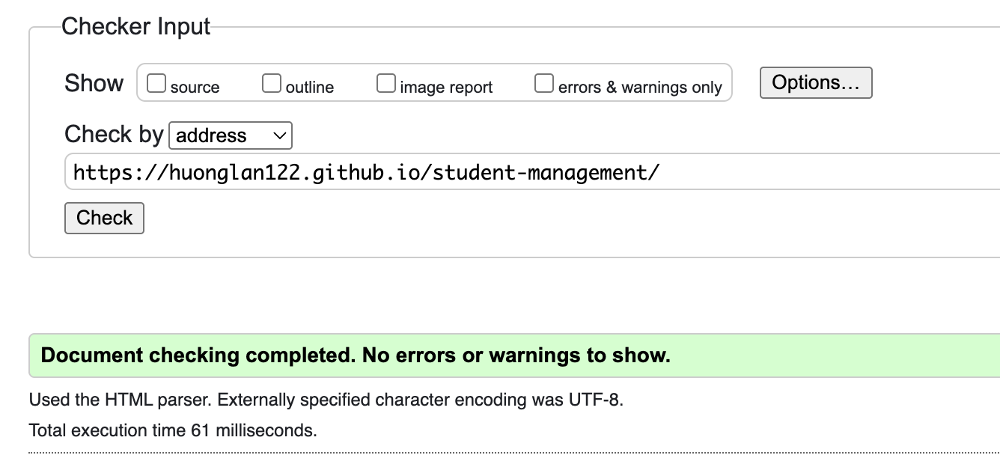
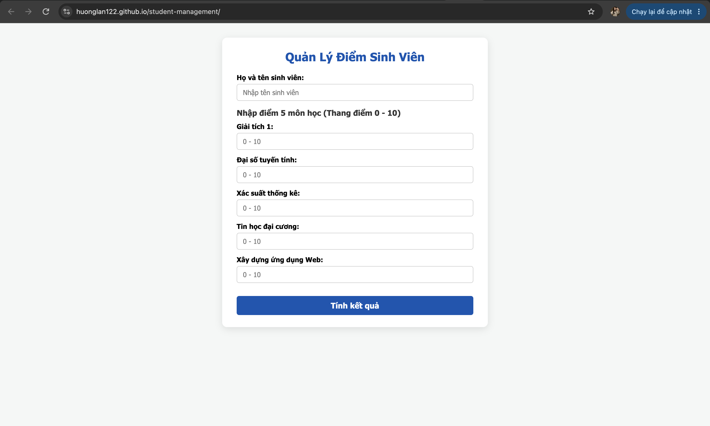
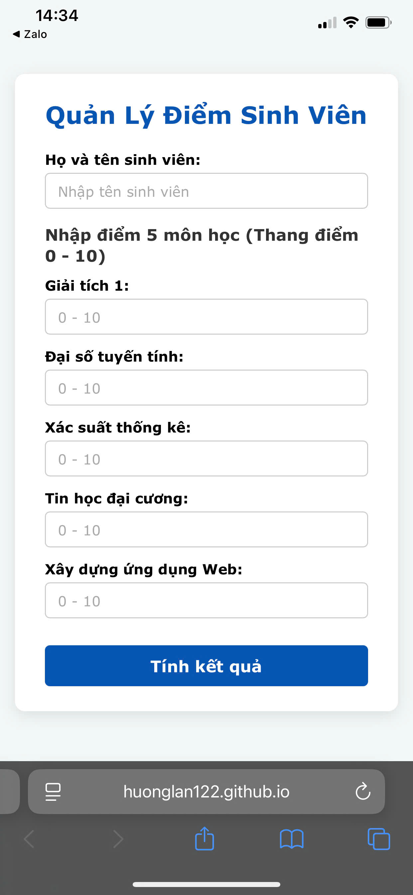

# WEBSITE QUẢN LÝ ĐIỂM SINH VIÊN

## 1. Giới thiệu dự án

**Quản Lý Điểm Sinh Viên** là website hỗ trợ nhập thông tin sinh viên, quản lý điểm các môn học, tính điểm trung bình và xếp loại kết quả học tập. Website được xây dựng bằng HTML, CSS và JavaScript, với giao diện đơn giản, dễ sử dụng.

**Website:** [Truy cập Quản Lý Điểm Sinh Viên](https://huonglan122.github.io/student-management/)

**Mã nguồn:** [GitHub – student-management](https://github.com/huonglan122/student-management)

## 2. Chức năng chính

- Nhập họ tên sinh viên.
- Nhập điểm của năm môn học trên thang điểm từ 0 đến 10.
- Tính điểm trung bình dựa trên dữ liệu được nhập.
- Hiển thị kết quả học tập và xếp loại theo quy tắc được lập trình.
- Trình bày thông tin và kết quả theo bố cục trực quan, dễ theo dõi.

## 3. Kiểm tra tuân thủ trình xác thực W3C

Website được kiểm tra bằng công cụ W3C Validator nhằm phát hiện các lỗi trong cấu trúc HTML và cải thiện khả năng tuân thủ tiêu chuẩn web.

- **Công cụ kiểm tra:** [W3C Markup Validation Service](https://validator.w3.org/)
- **Website được kiểm tra:** [Quản Lý Điểm Sinh Viên](https://huonglan122.github.io/student-management/)
- **Kết quả kiểm tra:** [Cập nhật kết quả thực tế sau khi xác thực và sửa lỗi.]

### Minh chứng

## 4. Kiểm tra khả năng đáp ứng (Responsive Design)

Website được kiểm tra trên các kích thước màn hình khác nhau nhằm đánh giá khả năng hiển thị của giao diện, biểu mẫu nhập điểm, nút chức năng và phần kết quả.

### 4.1. Giao diện trên máy tính

### 4.2. Giao diện trên điện thoại

**Đánh giá:** [Bổ sung nhận xét dựa trên kết quả kiểm tra thực tế, chẳng hạn bố cục có phù hợp với màn hình nhỏ hay không, nội dung có bị tràn và các nút có dễ thao tác hay không.]

## 5. Thiết kế giao diện và tệp CSS

Giao diện website được định dạng bằng CSS nhằm xây dựng bố cục rõ ràng, thống nhất màu sắc, kiểu chữ và cách trình bày các thành phần. Các quy tắc CSS góp phần cải thiện tính thẩm mỹ và trải nghiệm sử dụng.

**Tệp CSS:** [Xem mã nguồn style.css](style.css)

### 5.1. Minh chứng giao diện website

### 5.2. Minh chứng mã nguồn CSS

## 6. Cấu trúc mã nguồn

| Tệp | Chức năng |
|---|---|
| `index.html` | Xây dựng cấu trúc và các thành phần giao diện website. |
| `style.css` | Định dạng bố cục, màu sắc, kiểu chữ và giao diện. |
| `script.js` | Xử lý dữ liệu nhập, tính điểm trung bình và xếp loại học tập. |

- [Xem index.html](index.html)
- [Xem style.css](style.css)
- [Xem script.js](script.js)

## 7. Kết luận

Website Quản Lý Điểm Sinh Viên được xây dựng nhằm vận dụng kiến thức HTML, CSS và JavaScript vào việc phát triển một ứng dụng web có chức năng cụ thể. Dự án tập trung vào khả năng nhập liệu, xử lý điểm số, trình bày kết quả và thiết kế giao diện thân thiện với người dùng.

Thông qua quá trình xây dựng và kiểm tra website, dự án hướng đến việc hoàn thiện cấu trúc HTML, nâng cao khả năng hiển thị trên nhiều thiết bị và tổ chức mã nguồn rõ ràng, dễ bảo trì.

**Liên kết website:** [https://huonglan122.github.io/student-management/](https://huonglan122.github.io/student-management/)
